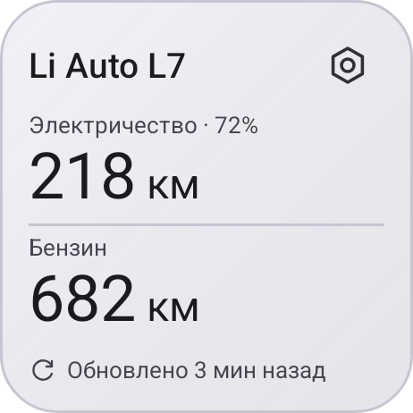
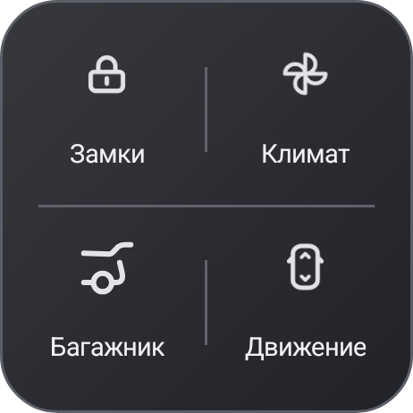

<p align="center"></p>
<h1 align="center">Li Widget</h1>
<p align="center">Your Li Auto, on your Android home screen.</p>
<p align="center"><a href="README.md">Русский</a> · <b>English</b></p>

**An unofficial companion for the original Li Auto widget.** Customize its appearance and translate known labels while keeping the original controls and their handlers. The original Li Auto app must be installed separately.

## Download 1.0 · build 21

**[Download APK](https://github.com/alexbel123/li-widget/releases/latest/download/Li-Widget-1.0.apk)** · **[Source code ZIP](https://github.com/alexbel123/li-widget/releases/latest/download/Li-Widget-1.0-source.zip)** · [APK with installation instructions (ZIP)](https://github.com/alexbel123/li-widget/releases/latest/download/Li-Widget-1.0.zip) · [Release page](https://github.com/alexbel123/li-widget/releases/latest)

You can install this APK over build 20. The source archive includes the code for this version, the build tools and the MIT license. [SHA-256 checksums](https://github.com/alexbel123/li-widget/releases/latest/download/SHA256SUMS.txt)

<table>
<tr><th>Format</th><th>Light theme</th><th>Dark theme</th></tr>
<tr><td>Minimal · 2×1</td><td></td><td></td></tr>
<tr><td>Range · 2×2</td><td></td><td></td></tr>
<tr><td>Favorites · 2×2</td><td></td><td></td></tr>
</table>

*Actual native rendering of build 19 on an Android emulator, with synthetic readings and no owner data. The UI also supports English. [All seven formats and the format picker](docs/WIDGETS.md).*

## Features

- Russian and English for the companion app, widgets and update notification.
- Light, dark, pure black and system themes. Black stays `#000000`.
- Android system neutral colors or a neutral gray palette.
- Per-widget styling, matte and glass surfaces, text size, optional battery percentage and update time. [System themes](docs/THEMING.md).
- Vehicle avatar: L6/L7/L8/L9 illustrations with paint selection, or a photo from the system picker. [Avatars](docs/AVATARS.md).
- A brief lightning pulse when charging percentage or remaining time changes, then a static icon.
- Seven Android picker entries: overview 4×2, large 4×3, minimal 2×1, range 2×2, favorites 4×1 and 2×2, charging 4×2. [Sizes and behavior](docs/WIDGETS.md).
- Minimal resizes down to **110 × 48 dp**, square formats to **110 × 110 dp**; the launcher determines cell occupancy.
- Four actions selected and reordered in the original Li Auto editor.
- Tap Minimal, Range or Charging to request an update through the original Li Auto handler. The settings icon opens appearance settings separately.
- **Move** opens the original forward/backward remote-movement interface.
- Stale-data indication without inventing a date for cached timestamps.

## Installation

1. Install the APK from [Releases](https://github.com/alexbel123/li-widget/releases/latest) on Android 12 or newer. If requested, allow this browser or file manager to install apps.
2. Open the original Li Auto app and sign in to your vehicle account.
3. Open Li Widget, choose **Connect Li Auto**, and approve Android's widget-binding request.
4. Allow the ongoing update notification. In the Android widget picker → **Li Widget**, choose one of the seven formats. Alternatively, use **New widget → Style → Widget type → Add to home screen** in the app.
5. Choose **Style → Language → English**, then customize the appearance. Use **Buttons** to open the original action editor.

Updates signed with the same key install over the previous version. [Detailed setup and troubleshooting](docs/INSTALL.md).

## Compatibility

Android 12+ is required. Instrumented checks ran on Android 16 / API 36 with Pixel Launcher. The companion is designed around L7 and the L series, using the widget structure from Li Auto **8.28.3 (7020)**, package `com.chehejia.oc.m01`. Actual vehicle commands were not tested with a connected car or owner account.

The original app determines available functions, confirmations and restrictions. New Li Auto versions may break compatibility. Its screens and button editor are not translated. Unknown messages are retained as received. An update timestamp does not prove that the car is online. Cabin temperature is not displayed because the inspected original widget does not supply a measured reading. [Verification and limitations](docs/VERIFICATION.md).

## Privacy and architecture

With your approval, Android lets Li Widget host the original widget through `AppWidgetHost`. It styles the received `RemoteViews` and translates known text while preserving the original `PendingIntent` handlers. A foreground service with an ongoing notification keeps the presentation updated.

Li Widget does not ask for credentials, account tokens or VIN. It has no network client, ads or analytics, and requests no internet, Bluetooth, location or contacts permissions. Preferences and an update timestamp are stored locally. The original app's data practices apply separately. [Privacy](PRIVACY.md).

## Build and contribute

Java and standard Android APIs, without Gradle or third-party runtime libraries. Requirements: Python 3.10+, JDK 21, Android SDK Platform 36, Build Tools 36.1.0.

```sh
python tools/check_release.py
python build.py --sdk /path/to/android-sdk
```

The local build generates its own key in ignored `.local/`. This key differs from the published APK's key. [Build and signing](docs/BUILD.md) · [Contributing](CONTRIBUTING.md) · [Changelog](CHANGELOG.md).

## License and support

Project code, documentation and original artwork are [MIT licensed](LICENSE). Li Auto / 理想汽车 and related marks belong to their respective owners. This independent project is not affiliated with or endorsed by Li Auto. It does not distribute the original APK, its code or extracted artwork. MIT does not apply to the original app. [Third-party notices](THIRD_PARTY_NOTICES.md).

Report bugs and suggestions in [Issues](https://github.com/alexbel123/li-widget/issues). Remove account information, VIN and personal data from reports and screenshots. Report vulnerabilities [privately](https://github.com/alexbel123/li-widget/security/advisories/new); see [SECURITY.md](SECURITY.md).
