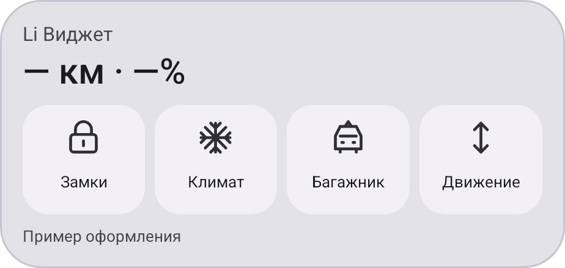
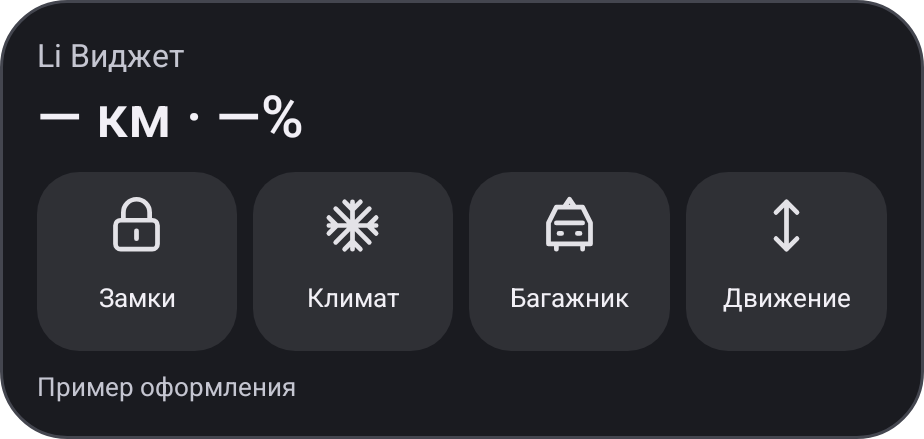

<p align="center"></p>
<h1 align="center">Li Widget</h1>
<p align="center">Ваш Li Auto — на главном экране Android.</p>
<p align="center"><b>Русский</b> · <a href="README.en.md">English</a></p>
<p align="center">
  <a href="https://github.com/alexbel123/li-widget/releases/latest"></a>
  <a href="LICENSE"></a>
  
  <a href="https://github.com/alexbel123/li-widget/actions/workflows/build.yml"></a>
</p>

**Неофициальный компаньон для штатного виджета Li Auto.** Настраивает оформление и переводит известные подписи, сохраняя оригинальные кнопки и их обработчики. Оригинальное приложение Li Auto должно быть установлено отдельно.

## Скачать 1.0

**[Установить APK](https://github.com/alexbel123/li-widget/releases/latest/download/Li-Widget-1.0.apk)** · **[Скачать ZIP](https://github.com/alexbel123/li-widget/releases/latest/download/Li-Widget-1.0.zip)** · [Все файлы релиза](https://github.com/alexbel123/li-widget/releases/latest)

ZIP содержит тот же APK, краткую инструкцию и его контрольную сумму. Исходники доступны в репозитории и в архиве **Source code** на странице релиза. `SHA256SUMS.txt` позволяет проверить загруженные файлы.

<table>
  <tr><th>Светлая тема</th><th>Тёмная тема</th></tr>
  <tr><td></td><td></td></tr>
</table>

*Это предпросмотр из меню виджетов Android с собственной графикой проекта. Прочерки означают отсутствие данных. Подключённый виджет показывает данные и исходные значки установленного Li Auto; их состояния и доступность зависят от автомобиля.*

## Возможности

- Русский и английский язык приложения, виджетов и уведомления.
- Светлая, тёмная, полностью чёрная и системная темы.
- Системные нейтральные цвета Android или нейтральная серая палитра. Чёрный фон остаётся `#000000`.
- Индивидуальное оформление каждого виджета, компактный и подробный форматы, размер текста, отображение заряда и времени обновления.
- Изменение размера на рабочем столе, минимум **250 × 110 dp**. Число занятых ячеек определяет лаунчер.
- Четыре действия с выбором и перестановкой через штатный редактор Li Auto.
- Подпись **«Движение»** для меню дистанционного перемещения вперёд и назад; названия проверены для L-серии.
- Отметка устаревания данных без выдуманной даты последнего обновления.

## Установка

1. Скачайте APK из раздела [Releases](https://github.com/alexbel123/li-widget/releases/latest) и установите на Android 12 или новее. При необходимости разрешите установку этому браузеру или файловому менеджеру.
2. Откройте оригинальное приложение Li Auto и войдите в свой аккаунт.
3. Откройте Li Widget → **«Подключить Li Auto»**. Подтвердите системный запрос Android на использование штатного виджета.
4. Разрешите уведомление службы обновления и добавьте Li Widget на главный экран.
5. Выберите язык и оформление в разделе **«Вид»**, действия — в разделе **«Кнопки»**.

При обновлении версии с той же подписью удалять приложение не нужно. [Подробная инструкция и решение проблем →](docs/INSTALL.md)

## Совместимость и ограничения

| Параметр | Состояние |
|---|---|
| Android | 12+; инструментальные проверки на Android 16 / API 36, Pixel Launcher |
| Оригинальное приложение | `com.chehejia.oc.m01`, структура виджета проверена для **8.28.3 (7020)** |
| Автомобили | Ориентировано на L7 и L-серию; реальные команды на автомобиле не проверялись |
| Кнопки | Доступные функции, подтверждения и ограничения определяет Li Auto |
| Температура салона | Не отображается: проверенный штатный виджет не передаёт измерение |
| Язык оригинального приложения | Его экраны и редактор кнопок не переводятся |

Новые версии Li Auto могут изменить структуру виджета и нарушить совместимость. Неизвестные сообщения источника показываются без изменений. Время обновления само по себе не подтверждает, что автомобиль сейчас в сети. [Результаты и границы проверки](docs/VERIFICATION.md) · [Переводы](docs/TRANSLATIONS.md) · [Температура салона](docs/CABIN-TEMPERATURE.md).

## Как это работает

После вашего подтверждения Android разрешает Li Widget размещать штатный виджет через `AppWidgetHost`. Компаньон получает его `RemoteViews`, меняет оформление и известные подписи, сохраняя исходные `PendingIntent`. Нажатия обрабатывает Li Auto. Служба с постоянным уведомлением поддерживает отображение обновлений.

Li Widget не запрашивает логин, пароль, токены или VIN. У него нет собственного сетевого клиента, рекламы и аналитики; разрешения на интернет, Bluetooth, геолокацию и контакты отсутствуют. Настройки и отметка обновления сохраняются локально. Правила обработки данных оригинальным приложением действуют отдельно. [Конфиденциальность →](PRIVACY.md)

## Для разработчиков

Java, стандартные Android API, без Gradle и сторонних библиотек времени выполнения. Нужны Python 3.10+, JDK 21, Android SDK Platform 36 и Build Tools 36.1.0.

```sh
python tools/check_release.py
python build.py --sdk /path/to/android-sdk
```

Локальная сборка создаёт собственный ключ в игнорируемой папке `.local/`. Он отличается от ключа опубликованного APK. [Сборка и подпись](docs/BUILD.md) · [Участие в проекте](CONTRIBUTING.md) · [История изменений](CHANGELOG.md).

## Лицензия и связь

Наш код, документация и собственная графика распространяются по [MIT](LICENSE). Li Auto / 理想汽车 и связанные обозначения принадлежат их правообладателям. Проект не связан с Li Auto, не одобрен производителем и не включает оригинальный APK, его код или извлечённые графические файлы. MIT не распространяется на оригинальное приложение. [Сторонние компоненты и обозначения](THIRD_PARTY_NOTICES.md).

Ошибки и предложения: [Issues](https://github.com/alexbel123/li-widget/issues). Не публикуйте VIN, данные аккаунта и снимки экрана с личной информацией. Для уязвимостей используйте [приватное сообщение](https://github.com/alexbel123/li-widget/security/advisories/new) по инструкции [SECURITY.md](SECURITY.md).
