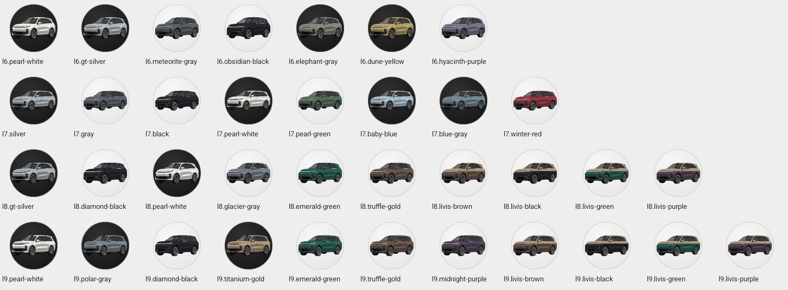
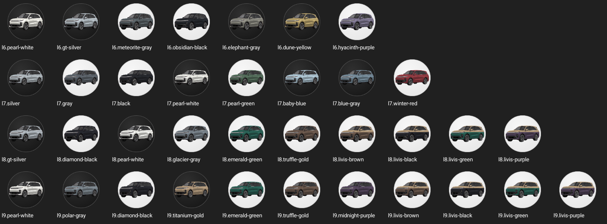

# Аватары L-серии / L-series avatars

Встроенные аватары показывают выбранную модель и цвет кузова. Палитра охватывает китайские версии [Li L6 2026](https://www.lixiang.com/l6), [Li L7 Smart Refresh](https://www.liauto.com/L7), [Li L8 2026](https://www.lixiang.com/l8) и [Li L9 2026](https://www.lixiang.com/l9). У L7 также есть [красный цвет из палитры запуска 2023 года](https://ir.lixiang.com/news-releases/news-release-details/li-auto-inc-launches-li-l7-five-seat-flagship-family-suv). Доступность цветов зависит от года, страны и комплектации. Оттенки в приложении приблизительные.

Иллюстрации сгенерированы для проекта встроенным imagegen. Это визуализация четырёх моделей в ракурсе три четверти. Прозрачный атлас содержит кузова с пурпурной маской окраски, на которую приложение накладывает выбранный оттенок. Изображения конфигуратора в APK не входят.

The built-in avatar gallery covers the Chinese-market L6, L7, L8 and L9 palettes above. Color swatches approximate the finish on a screen. The atlas is generated illustration art. Photo selection uses the Android system picker.

## Контраст аватаров / Avatar contrast

В сборке 19 круглый фон иллюстраций нейтральный: светлый или графитовый. Вариант выбирается по контрасту с кузовом и крышей, включая двухцветные окраски. Цвет самого автомобиля сохраняется, тонкий контур отделяет круг от поверхности виджета. Фотографии из галереи не перекрашиваются.

Build 19 uses neutral light or graphite circular backgrounds, choosing the better contrast with both body and roof paint. A thin rim defines the circle on the widget surface. Imported photos are not recolored.

Нативная отрисовка всех вариантов / Native rendering of all catalog paints:

