# Widget formats / Форматы виджетов

Implemented in version 1.0, build17. Each row is a separate Android AppWidget provider, not a picture or a different setting inside one fixed-size provider. Existing overview widgets retain their provider and settings when upgrading.

Реализовано в версии 1.0, сборка 17. Каждый вариант зарегистрирован отдельно в каталоге виджетов Android. Старые универсальные виджеты и их настройки сохраняются при обновлении.

| Формат / Format | Ячейки / Target cells | Минимум / Minimum dp | Содержимое / Contents |
|---|---|---|---|
| Универсальный / Overview | 4×2 | 250×110 | Имя, запас хода и четыре кнопки; адаптивная компоновка / Name, range and four controls |
| Большой / Large | 4×3 | 250×180 | Увеличенная шапка, аватар и четыре кнопки / Larger header, avatar and four controls |
| Минимальный / Minimal | 2×1 | 110×48 | Электрический и бензиновый запас хода / Electric and fuel range |
| Запас хода / Range | 2×2 | 110×110 | Два показателя запаса хода, батарея и обновление / Two range readings, battery and freshness |
| Избранное / Favorites | 4×1 | 250×48 | Четыре кнопки в строку / Four controls in a row |
| Избранное / Favorites | 2×2 | 110×110 | Четыре кнопки сеткой / Four controls in a grid |
| Зарядка / Charging | 4×2 | 250×110 | Процент батареи, статус и исходное время зарядки / Battery percentage, state and original countdown |

## Добавление / Adding

Откройте Li Widget, выберите «Новый виджет» → «Вид» → «Тип виджета», затем «Добавить виджет». Также все варианты доступны через каталог виджетов рабочего стола. Для уже размещённого экземпляра тип закреплён за его Android-провайдером; для другого типа добавьте новый экземпляр. Оформление настраивается отдельно для каждого.

In Li Widget, choose New widget → Style → Widget type → Add widget, or use your launcher's widget picker. Existing widgets keep their provider type; add another widget to change format. Styling remains per widget.

Размер в ячейках — ориентир для лаунчера: физическая сетка и системные отступы зависят от устройства. У маленьких форматов собственные ограничения размера; они не наследуют минимум универсального виджета. [Android sizing documentation](https://developer.android.com/develop/ui/views/appwidgets/layouts).

## Данные и кнопки / Data and controls

Все значения берутся из текущего штатного виджета Li Auto. Если при зарядке исходное поле запаса хода заменено процентом, вместо недоступного запаса хода отображается «—». Скрытые значения не подставляются из старого снимка. Получение и перевод времени зарядки используют прежний механизм; отдельного расчёта времени нет.

«Избранное» показывает четыре действия, выбранные в штатном редакторе Li Auto. Обе компоновки сохраняют исходные PendingIntent, подтверждения, отключённые состояния и активные значки. Выбор кнопок остаётся общим с исходной панелью Li Auto. Приложение не создаёт собственные команды автомобилю.

All readings come from the current original widget. Unavailable or hidden range values show a dash, including when charging replaces range with a percentage. Countdown handling is unchanged. Favorites preserves the original four actions, their PendingIntents and state; use the Li Auto editor to select and reorder them. The selection is shared with that original panel.

Тестовые значения показываются только в образце редактора без подключения. На рабочем столе без источника отображается предложение подключить Li Auto.

Sample values are confined to the unconnected editor preview. An unconnected home-screen widget shows a connection prompt.

## Снимки сборки 17 / Build 17 screenshots

Настоящие RemoteViews установленного APK, отрисованные в эмуляторе Android с синтетическими показаниями. Это не изображения-концепции. Исходные значки и доступность действий при подключении определяет Li Auto.

These are native RemoteViews rendered from the installed APK on an Android emulator, using synthetic readings. They are not concept images. The connected Li Auto app supplies the original action icons and availability.

<table>
<tr><th>Формат / Format</th><th>Светлая / Light</th><th>Тёмная / Dark</th></tr>
<tr><td>Универсальный / Overview · 4×2</td><td>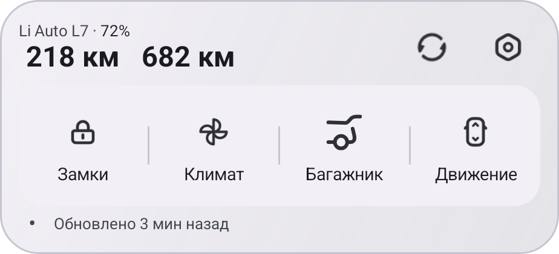</td><td>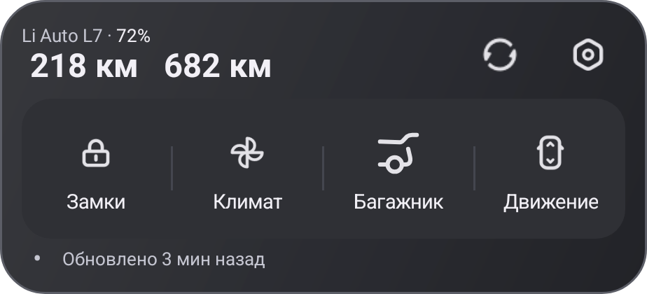</td></tr>
<tr><td>Большой / Large · 4×3</td><td>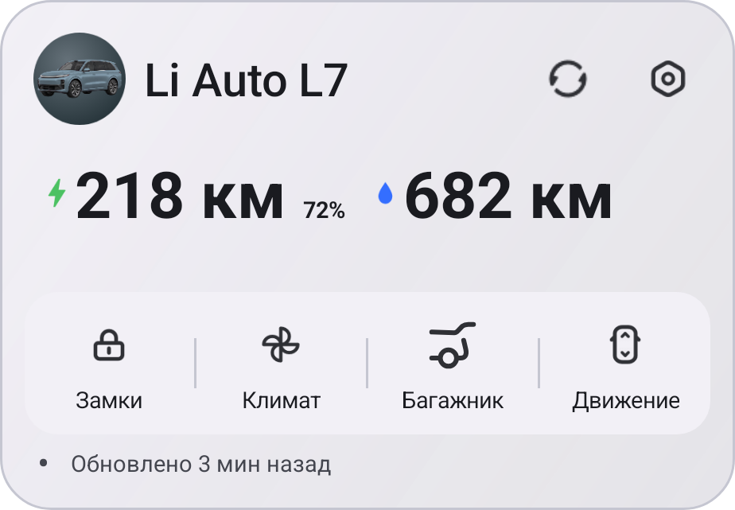</td><td>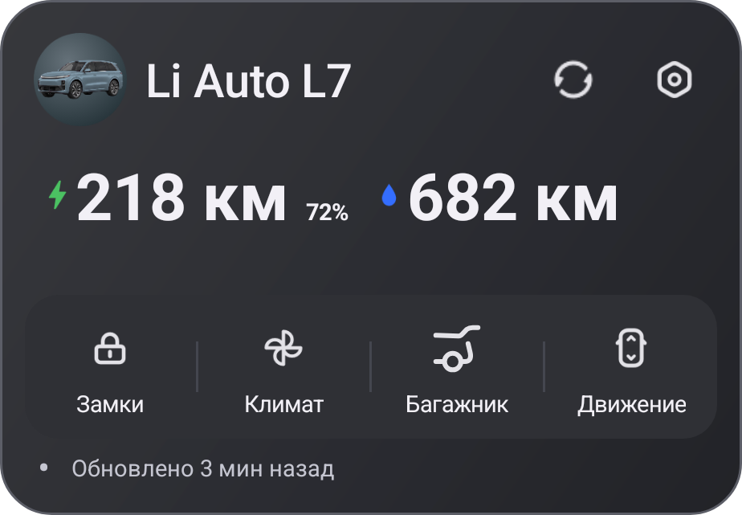</td></tr>
<tr><td>Минимальный / Minimal · 2×1</td><td>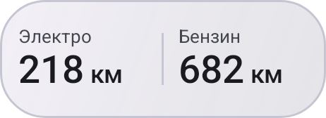</td><td>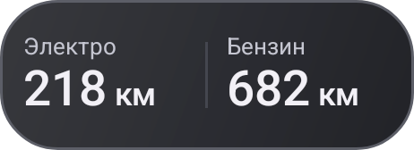</td></tr>
<tr><td>Запас хода / Range · 2×2</td><td>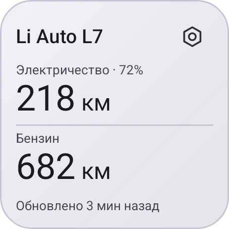</td><td>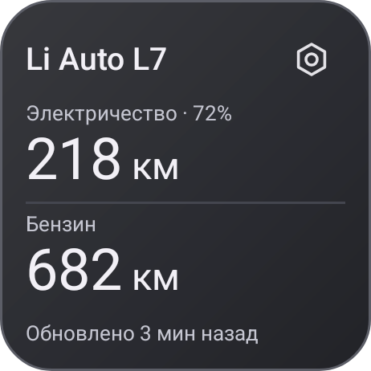</td></tr>
<tr><td>Избранное / Favorites · 4×1</td><td>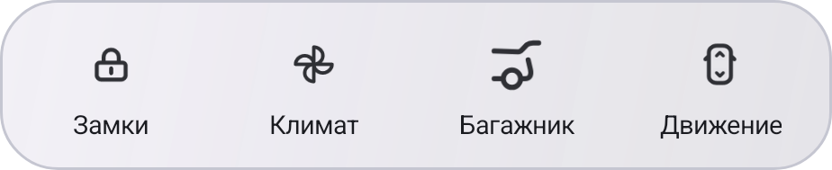</td><td>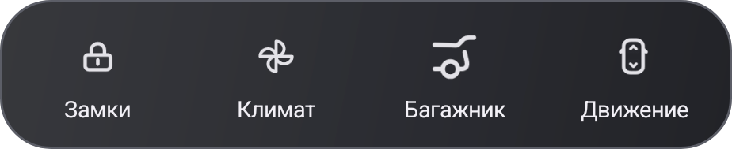</td></tr>
<tr><td>Избранное / Favorites · 2×2</td><td>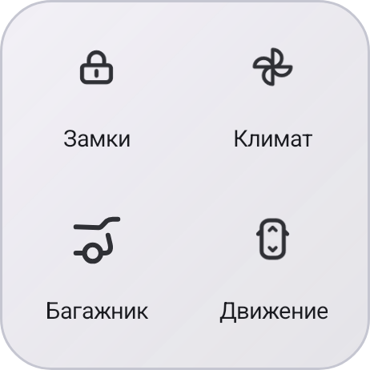</td><td>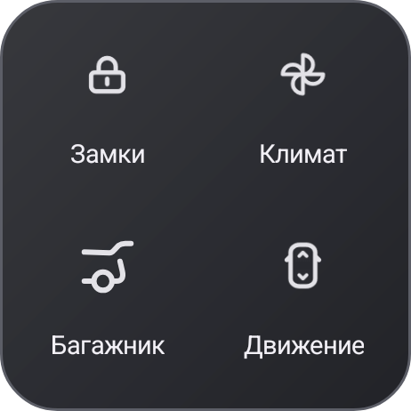</td></tr>
<tr><td>Зарядка / Charging · 4×2</td><td>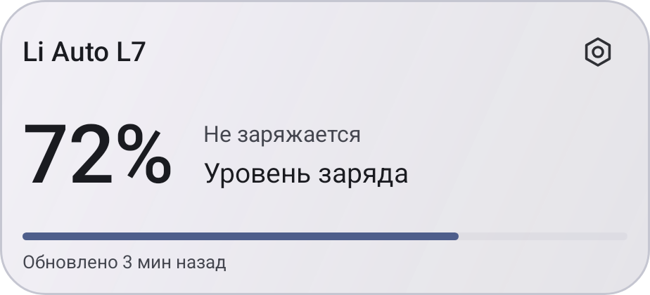</td><td>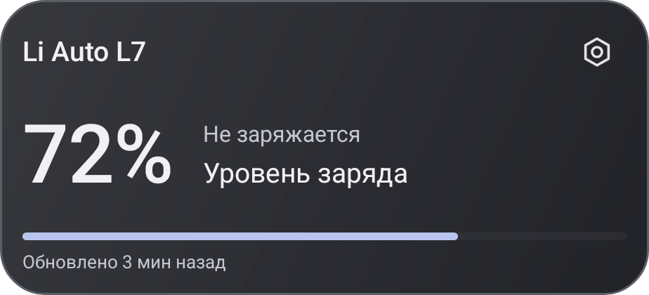</td></tr>
</table>

Меню типов в приложении и системный диалог добавления 2×2 / In-app format picker and Android 2×2 pin dialog:

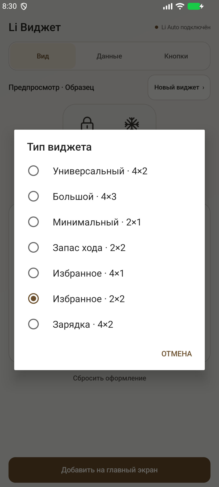 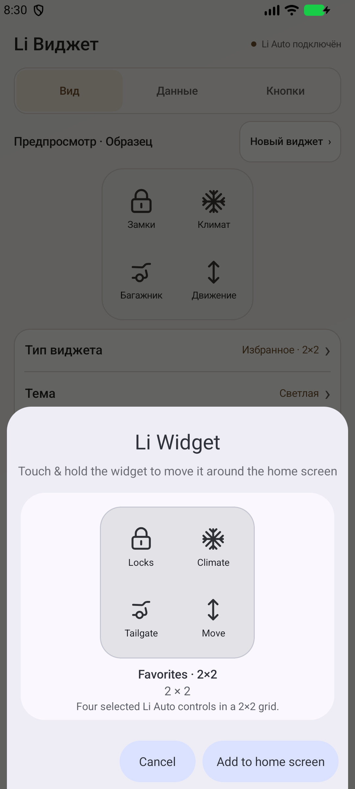

